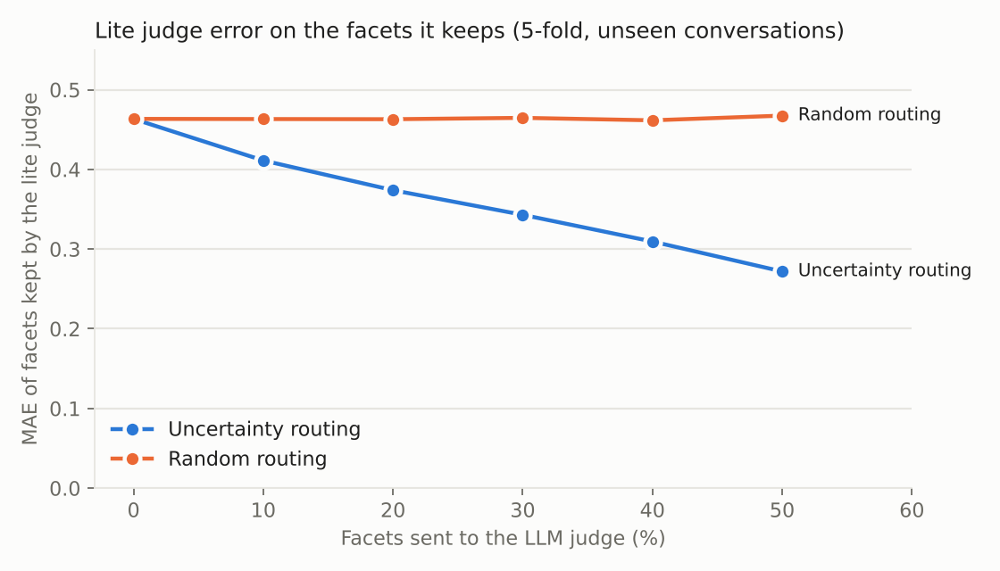

# Ahoum — Conversation Evaluation Benchmark (v3)

Scores a conversation on **399 facets** (1–5 score + confidence) and, unlike v1/v2, **measures how good those scores are.**

v3 turns a prompt-the-LLM wrapper into a validated evaluation system:

1. **Audited** the Llama 3.1 8B judge's own outputs and fixed what was broken.
2. **Checked the judge against human labels** (GoEmotions, 58k human-annotated comments).
3. **Distilled** the judge into a CPU model (LightGBM + GloVe + a human-label emotion encoder) that scores all 399 facets in **~40 ms** with no API.
4. **Routed by uncertainty:** a second model predicts where the CPU judge is likely wrong, and only those facets go to the LLM (**Hybrid mode**).

Every number below is cross-validated and comes from a script in `scripts/`. `./reproduce.sh` regenerates all of them on a CPU in about 12 minutes.

**Live demo:** https://ahoum-eval.onrender.com

---

## Results at a glance

| What | Result |
|---|---|
| Raw Llama-judge labels that were unusable (dropped or silent neutral fallback) | **13.9 %** (2,777 / 19,950) |
| Returned keys that didn't match a facet (mangled / merged / hallucinated) | **8.5 %** → 1,559 recovered by the new `FacetMatcher` |
| Llama judge vs independent human-label emotion model (14 emotion facets, 50 convs) | mean Spearman **0.35**, **9 / 14** significant (permutation p < 0.05) |
| Emotion encoder on GoEmotions test (28 labels, human-annotated) | macro-F1 **0.458** (BERT-base in the paper: 0.46), macro-AUROC 0.899 |
| Lite judge vs Llama judge, **unseen conversations** (5-fold) | QWK **0.821**, within ±1: **96.1 %**, MAE 0.463 |
| Lite judge, **unseen conversations *and* unseen facets** (zero-shot) | Spearman **0.533** (kNN facet-prior baseline 0.516) |
| Uncertainty model: predicted vs actual error | Spearman **0.64** |
| Hybrid, 50 % of facets sent to the LLM | MAE on the facets kept on CPU **0.27** vs **0.47** for a random half |
| Hybrid default (30 % to LLM) | **5 LLM calls instead of 16** per conversation (−69 %) |
| Lite judge vs **human labels**, out-of-domain (1,000 GoEmotions comments) | macro-AUROC **0.785** over 6 emotion facets |
| Lite judge latency, all 399 facets | median **40 ms** on 2 CPU threads, models total ≈ 37 MB |

---

## 1. Auditing the LLM judge (`scripts/audit_teacher.py`)

The original pipeline scored 50 conversations × 399 facets with Llama 3.1 8B (Groq) and stored the results in `results/all_scores.json`. Nobody had looked at how much of that was actually usable.

| Finding | Count | Cause | Fix in v3 |
|---|---|---|---|
| Keys repaired (casing, numbering, `Heading: Facet` merges) | 1,559 | 30 CSV rows end in `:` (e.g. `Democratic Leadership:`); the model read them as section headings and merged them with the next facet | Clean facet names before prompting + `FacetMatcher` canonicaliser |
| Hallucinated facet keys | 68 | Model invented facets (`Therapist Self-Awareness`) | Discarded and counted |
| Facets missing after repair | 847 (4.3 %) | Model silently skipped facets in long batches | One targeted re-ask for missing facets |
| Neutral fallbacks `{score 3, conf 0.0}` | 1,930 (9.7 %) | Whole batches failing JSON parsing | JSON mode, then explicit `"source": "fallback"` so they can't pass as real scores |
| Facets that are constant across 50 very different conversations | 62 | Facets unobservable from text (`Basophil count`, `Quran khatam cycles per year`) | Reported. The lite judge learns these almost perfectly, which is why routing pays off |

## 2. Is the LLM judge measuring anything real?

There are no human labels for these 399 facets, so I used the facets that have a clear counterpart in **GoEmotions** (Demszky et al., 2020).

**Emotion encoder** (`scripts/train_emotion.py`): TF-IDF word 1–2-grams + char 2–5-grams → one-vs-rest logistic regression, per-label thresholds tuned on the dev split. On the official test split it gets **macro-F1 0.458**, the same as the paper's BERT-base baseline (0.46), from a 26 MB CPU model.

**Construct validity of the Llama judge** (`scripts/validate_teacher_emotions.py`): across the 50 conversations I compared the judge's score on a facet with the encoder's probability for the matching emotions.

| Facet | Emotions | Spearman |
|---|---|---|
| Disrespect | disapproval, disgust, anger | 0.53 |
| Discontentment | disappointment, disapproval, annoyance | 0.52 |
| Joyfulness | joy, amusement, excitement | 0.49 |
| Hostility | anger, annoyance, disgust | 0.45 |
| Depression: sadness/hopelessness | sadness, grief, disappointment | 0.43 |
| … 14 facets total | | mean 0.35, 9/14 with p < 0.05 |

So the judge does track real emotional content on these facets, though weaker ones (Hope, Fearfulness, Moroseness) are close to noise. Full table: `reports/teacher_emotion_validity.json`.

`scripts/validate_against_humans.py --llm` runs the same human-label test on the **Llama judge itself** (needs `GROQ_API_KEY`, about 1,000 cached calls).

## 3. Lite judge: distilling the LLM (`lite/`, `scripts/train_lite.py`)

**Training data:** 17,173 valid Llama labels (50 conversations × 389 facets, after the audit cleanup), weighted by the judge's confidence.

**Features for each (conversation, facet) pair (257):**
- *Semantic match:* GloVe-100d similarity between the facet name and the conversation, per turn and per word. Raw values plus versions z-scored against a reference corpus, so a facet whose wording sits close to everything isn't over-scored.
- *Emotion head:* a per-facet ridge regression on the conversation's GoEmotions profile, **shrunk towards a semantic prior** (`Joyfulness` starts out tied to `joy`). Computed out-of-fold so labels don't leak.
- *Facet prior:* the facet's leave-one-out teacher mean and std. For unseen facets it's a kNN prior from similar facet names; 30 % of facets are trained in this zero-shot mode so one model handles both cases.
- *Conversation shape:* turns, length, speakers, question/exclamation rate, negation, I/you rate, stage directions.

**Model:** residual target (score − facet prior) = 0.5 × emotion head + 0.5 × LightGBM. A second LightGBM predicts |error| from out-of-fold residuals; this is the uncertainty estimate used for routing.

### A. Unseen conversations (GroupKFold over conversations, 17,173 predictions)

| | MAE ↓ | QWK ↑ | Spearman ↑ | Within ±1 ↑ | Ranks convs within a facet ↑ |
|---|---|---|---|---|---|
| Global mean | 1.106 | 0.000 | −0.03 | 75.3 % | — |
| Per-facet teacher mean | 0.477 | 0.805 | 0.837 | 95.3 % | — (constant) |
| **Lite judge** | **0.463** | **0.821** | **0.851** | **96.1 %** | **0.152** (all), **0.32** (emotion / high-variance facets) |

### B. Unseen conversations and unseen facets (5×5 grid split, 3,431 predictions)

| | MAE ↓ | QWK ↑ | Spearman ↑ |
|---|---|---|---|
| Global mean | 1.112 | 0.000 | −0.05 |
| kNN facet prior | 0.892 | 0.425 | 0.516 |
| **Lite judge (zero-shot)** | **0.879** | **0.440** | **0.533** |

### Uncertainty routing



| Share sent to LLM | MAE on facets kept on CPU | Random facets, same count | Overall MAE vs teacher |
|---|---|---|---|
| 0 % | 0.463 | 0.463 | 0.463 |
| 10 % | 0.411 | 0.463 | 0.370 |
| 30 % | 0.343 | 0.465 | 0.240 |
| 50 % | 0.272 | 0.468 | 0.136 |

### Human-label check, out of domain (`scripts/validate_against_humans.py`)

The lite judge was trained only on Llama labels for 50 long dialogues. I tested it on 1,000 single Reddit comments from the GoEmotions **test** split, against the human annotations:

| Facet | Lite judge AUROC | Emotion encoder alone (in-domain reference) |
|---|---|---|
| Fearfulness | 0.913 | 0.958 |
| Depression: sadness | 0.823 | 0.893 |
| Hostility | 0.811 | 0.859 |
| Disrespect | 0.801 | 0.852 |
| Joyfulness | 0.686 | 0.943 |
| Compassion | 0.675 | 0.917 |
| **Macro** | **0.785** | 0.904 |

The first version of the emotion head scored 0.47 on Joyfulness (below chance). Its per-facet regression, fitted on only 40 conversations, had latched onto unrelated emotions. Adding the semantic prior fixed it. The prior's strength was chosen on the cross-validation in section A, not on this test set.

---

## Modes

| Mode | What runs | Needs API key | Typical latency |
|---|---|---|---|
| `lite` | Lite judge on all facets | no | ~40 ms |
| `hybrid` (default when a key is set) | Lite judge, plus Llama on the 30 % most uncertain facets | yes | 5 LLM batches |
| `llm` | Llama 3.1 8B on every facet (v2 behaviour, with the fixes above) | yes | 16 LLM batches |

Each facet in the output is tagged with `source: lite | llm | fallback`.

## Architecture

```text
conversation ──► LiteJudge (CPU, ~40 ms) ──► score + predicted error for all 399 facets
                    │  GloVe match · emotion head (GoEmotions) · facet prior · LightGBM
                    ▼
            sort by predicted error ──► top 30% ──► Llama 3.1 8B via Groq
                                                    (batched, concurrent, JSON mode,
                                                     re-ask on missing, LRU cache,
                                                     FacetMatcher canonicalisation)
                    ▼
            merged scores (source-tagged) ──► Flask async jobs ──► dashboard
```

## API

| Endpoint | Method | Description |
|---|---|---|
| `/score` | POST `{conversation, mode?, llm_share?}` | Start an async job, returns `job_id` |
| `/status/<job_id>` | GET | Progress and results |
| `/api/score` | POST `{conversation, mode?, facets?}` | Synchronous scoring (good for `lite`) |
| `/metrics` | GET | All evaluation reports as JSON |
| `/health` | GET | Model and LLM availability |

```bash
curl -s localhost:5000/api/score -H 'content-type: application/json' \
  -d '{"conversation":"A: I got the job!!\nB: I am so proud of you","mode":"lite"}'
```

## Run it

```bash
python3 -m venv venv && source venv/bin/activate
pip install -r requirements-dev.txt
cp .env.example .env          # optional: add GROQ_API_KEY for hybrid / llm modes
python app.py                 # http://localhost:5000
python -m pytest -q           # 21 tests, no API key needed (the LLM is faked)
./reproduce.sh                # rebuild every model + report from scratch
```

Docker: `docker compose up --build`. Render: `render.yaml` (Python 3.13, health check on `/health`).

## Project structure

```text
app.py                 Flask app: async jobs, sync API, /metrics, /health, input validation
hybrid.py              lite / hybrid / llm modes + uncertainty routing
scorer.py              LLM judge (Groq): JSON mode, re-ask, cache, stats, explicit fallbacks
facets.py              facet cleaning + FacetMatcher canonicaliser
lite/
  text.py              tokeniser, turn splitter, GloVe vectors
  features.py          (conversation, facet) feature builder
  emotion.py           GoEmotions emotion encoder
  emotion_head.py      per-facet emotion regression with semantic prior
  model.py             LiteJudge: training, OOF error model, predict, save/load
scripts/               audit, training, validation, figures (each writes reports/*.json)
models/                lite_judge.joblib (2 MB), emotion_encoder.joblib (26 MB), glove_50k_100d.npz (10 MB)
reports/               every number in this README + OOF predictions + figure
tests/                 pytest suite (facets, scorer with fake Groq, lite judge, app)
data/                  cleaned teacher labels, GoEmotions splits
results/, conversations/   original v1 data (50 generated conversations, Llama scores)
```

## Limitations (read before quoting numbers)

- **The teacher is an 8B LLM, not people.** "Agreement with the teacher" means agreement with Llama. Human grounding exists only for emotion facets (section 2).
- **50 conversations is small.** Most of the lite judge's agreement comes from knowing *which facets apply at all*. Its ability to rank conversations within a facet is modest overall (0.15) and better on facets with real signal (0.32). Hybrid mode exists for exactly this reason.
- The 50 conversations were themselves LLM-generated, so the in-domain numbers may be optimistic for real transcripts. The GoEmotions test is the out-of-domain check.
- Teacher self-consistency (run-to-run variance) wasn't re-measured in v3. It needs API calls: `score_all.py` plus a second run.

## Model information

| Component | Details |
|---|---|
| LLM judge | `llama-3.1-8b-instant` (Meta open weights, 8B) via Groq, temperature 0 |
| Word vectors | GloVe 6B 100d (Pennington et al., 2014), top 50k words, float16 |
| Emotion data | GoEmotions (Demszky et al., 2020), official splits |
| Lite judge | LightGBM 4.7 + scikit-learn 1.9, CPU only, no torch |

**Author:** Gella Jaya Rama Krishna, IIT Gandhinagar
